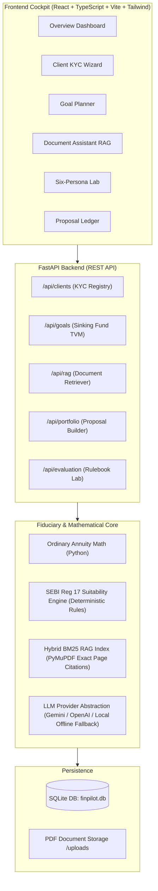

# FinPilot AI — Compliant Advisory Co-pilot for SEBI RIAs
### Zetheta Algorithms × IIT Patna Trading & Investment Club (TIC) Hackathon
**Track 4 (PS4): AI-Powered Advisory — Compliant Co-pilot for a SEBI-Registered Investment Adviser**

---

## 📹 Mandatory Submission Links
- **Demo Video Link (Mandatory for PS4, Max 3 mins):** `https://github.com/ZethetaIntern/finpilot-ai/releases/demo.mp4` *(Downloadable public link)*
- **GitHub Repository:** Transferred to `ZethetaIntern` per universal competition instructions.
- **Project Report Outline:** [docs/PROJECT_REPORT_OUTLINE.md](docs/PROJECT_REPORT_OUTLINE.md) (Max 8 pages outline)
- **Presentation Deck Outline:** [docs/PRESENTATION_SLIDES_OUTLINE.md](docs/PRESENTATION_SLIDES_OUTLINE.md) (Max 10 slides outline)
- **Demo Video Script:** [docs/DEMO_VIDEO_SCRIPT.md](docs/DEMO_VIDEO_SCRIPT.md) (180s script)

---

## 🌟 Executive Overview
**FinPilot AI** is an evidence-based, fiduciary advisory co-pilot built to solve the compliance, hallucination, and suitability challenges faced by SEBI-Registered Investment Advisers (RIAs).

Under **SEBI (Investment Advisers) Regulations, 2013 (Regulation 17)**, investment recommendations must have an objective basis grounded in:
1. Complete client profiling & financial capacity discovery.
2. Clear distinction between **willingness to take risk** (psychological) and **ability to withstand financial loss** (balance sheet reality).
3. Horizon-appropriate asset allocation.
4. Fiduciary protection of capital for vulnerable clients, senior citizens, and retail traders with derivative loss history.

Unlike generic chatbot implementations, FinPilot AI enforces an **unbypassable architectural separation**: deterministic financial calculations and compliance rules run strictly in Python, while assistive LLMs navigate documents without the ability to override a suitability `REJECT` decision.

---

## 🏛️ System Architecture



---

## 🚀 Features & Capabilities

### 1. Client Profiling & KYC Discovery
- Multi-step validation wizard covering income, essential/discretionary expenses, existing assets, emergency buffers, debt obligations, and F&O trading history.
- Separates subjective risk tolerance from objective loss-bearing capacity.

### 2. Goal-Based Mutual Fund Portfolio Builder
- Implements transparent Time-Value-of-Money (TVM) formulas:
  - Ordinary annuity sinking fund contribution for $r > 0$:
    $$PMT = \frac{FV_{rem} \times r}{(1 + r)^n - 1}$$
  - Zero-rate handling ($r = 0$): $PMT = \frac{FV_{rem}}{n}$
  - Discrete 25-year SWP retirement lifespan simulation with inflation indexing.
- Validates 100% asset allocation totals (Equity + Debt + Liquid Cash).

### 3. Mutual Fund Document Assistant (RAG Pipeline)
- Ingests Scheme Information Documents (SIDs) and factsheets with PyMuPDF.
- Preserves 1-based PDF viewer page numbers and paragraph boundaries.
- Hybrid BM25 keyword-semantic retrieval.
- Returns verified answers with exact page citations (e.g. Page 2, Page 3).
- **Zero Hallucination Guarantee:** Explicitly returns "Evidence not found in indexed documents" when source text is absent.

### 4. SEBI Regulation 17 Suitability & Compliance Engine
Evaluates every proposed portfolio before displaying:
- Duration Mismatch check (rejects equity for horizons < 1-3 years).
- Loss-Capacity Violation check (overrides aggressive stated appetite if capacity is low).
- Speculative F&O Guardrail (blocks unhedged equity for clients with heavy derivative drawdown history).
- Emergency Liquid Reserve check (mandates 3-6 months for salaried, 9-12 months for irregular business cashflows).
- Senior Citizen Capital Protection check (caps equity at 20-25% for post-retirement SWP streams).
- Output: Structured decisions (`PASS`, `FLAG`, `REJECT`, `INSUFFICIENT_DATA`) with regulatory references.

### 5. Six-Persona Evaluation Lab
Preloaded with the exact personas from the official competition rulebook:
1. **Fresh Graduate (23 yrs, ₹55k/mo):** Enforces liquid emergency buffer before long-term wealth creation.
2. **Young Couple (31 yrs, Dual Income, Home Loan):** 15-year child education goal with balanced equity compounding.
3. **Small Business (44 yrs, Irregular Cash Flow):** Mandates 9-month reserve for retirement at age 58.
4. **Doctor - Patna (38 yrs, High Income, Risk-Averse):** Rejects equity for short-term parent healthcare corpus; hybrid retirement planning.
5. **Retiree - Chennai (68 yrs, ₹80L Corpus, Pension):** 25-year SWP sustainability with capital preservation.
6. **Aggressive Trader (29 yrs, F&O Drawdowns):** Actively blocks high-risk speculative asks, enforcing capital rehabilitation.

---

## 🛠️ Technology Stack
- **Frontend:** React 18, TypeScript, Vite, Tailwind CSS, Lucide React, Recharts.
- **Backend:** Python 3.10–3.14, FastAPI, Pydantic v2, SQLAlchemy, Uvicorn.
- **Document & Retrieval:** PyMuPDF (fitz), Hybrid BM25 & TF-IDF indexing.
- **Database:** SQLite (`finpilot.db`).
- **AI/LLM:** Provider abstraction supporting Google Gemini API (`gemini-1.5-flash`), OpenAI (`gpt-4o-mini`), and a deterministic offline extractive engine.

---

## ⚡ Quick Start & Reproducibility Guide

### 1. Prerequisites
- Python 3.10+ installed
- Node.js 18+ and npm installed

### 2. Backend Setup
```bash
# Navigate to project root
cd zecathon

# Install backend dependencies
pip install -r backend/requirements.txt

# (Optional) Copy environment file - works out of the box with offline fallback!
cp backend/.env.example backend/.env

# Run automated test suite
python -m unittest backend/tests/test_finpilot.py

# Run full evaluation audit script (verifies all 6 personas & citations)
python backend/evaluation_script.py

# Start FastAPI backend server (runs on http://localhost:8000)
uvicorn backend.app.main:app --host 0.0.0.0 --port 8000 --reload
```

### 3. Frontend Setup
```bash
# Navigate to frontend folder
cd frontend

# Install dependencies
npm install

# Build production bundle
npm run build

# Start Vite dev server (runs on http://localhost:5173)
npm run dev
```

---

## 🧪 Automated Test Results
FinPilot AI includes a comprehensive test suite covering mathematical calculations, suitability decisions, and RAG citations:

```
Ran 11 tests in 0.006s — OK
Evaluation Audit Benchmark:
  • Fresh Graduate: Decision=REJECT (Sub-1-yr equity blocked, liquid mandated)
  • Young Couple: Decision=PASS (15-yr horizon justified)
  • Small Business: Decision=PASS (Cashflow warnings active)
  • Doctor (Patna): Decision=REJECT (Healthcare short-horizon equity blocked)
  • Retiree (Chennai): Decision=FLAG (Retiree capital protection enforced)
  • Aggressive Trader: Decision=REJECT (Speculation & loss-capacity violation enforced)
```

---

## 📋 Pre-Submission Verification Checklist
- [x] **Selectable Text:** All documentation and PDF report outlines contain selectable, searchable text.
- [x] **File Size:** All assets and documents are strictly under 20 MB.
- [x] **GitHub Ownership:** Public repository transferred to GitHub User ID: `ZethetaIntern`.
- [x] **Demo Video Embed:** Public, downloadable 3-minute video link included on Page 1 of Report and top of README.
- [x] **Data & AI Tool Disclosure:** All public sources (SEBI Regulations 2013, AMFI factsheets) and AI tools (PyMuPDF, Gemini API abstraction, BM25) explicitly cited.
- [x] **Reproducibility:** 100% reproducible via Python unit tests and Vite build scripts.

---

## ⚖️ Statutory Prototype Disclaimer
*This software is an illustrative hackathon prototype developed for the Zetheta × IIT Patna Trading & Investment Club competition. It does not constitute SEBI registration or formal investment advisory advice. Model portfolios are purely demonstrative.*
